<h1 align="center">svjeez</h1>

<p align="center">
  <b>Write motion in TypeScript, JSX optional. Ship one zero-JS <code>.svg</code>.</b>
</p>

<p align="center">
  
  <br>
  <sub><b>One spring track drives coil, morph, arrows, and counters</b> · 37 KB · 0 KB JS · <a href="examples/readme/hero.tsx"><code>examples/readme/hero.tsx</code></a></sub>
</p>

svjeez compiles a scene, written in JSX or with plain `h()` calls, into one animated SVG that works anywhere `` works: READMEs, docs, blogs, and email. Every graphic here is a live svjeez `.svg`. Toggle your theme to watch them adapt.

<p align="center">
  
  <br>
  <sub><b>From scene to one .svg</b> · drawn from Mermaid by <code>@svjeez/mermaid</code> · <a href="examples/readme/pipeline.ts"><code>examples/readme/pipeline.ts</code></a></sub>
</p>

## Quick start

```sh
npm install svjeez            # on Node 22+, also install tsx
npx svjeez svg scene.tsx --out scene.svg
npx svjeez dev scene.tsx      # preview with a scrubber and live reload
```

For JSX, point TypeScript at svjeez's runtime. Plain `.ts` scenes can drop the two `jsx` lines.

```json
{
  "compilerOptions": {
    "module": "NodeNext",
    "moduleResolution": "NodeNext",
    "jsx": "react-jsx",
    "jsxImportSource": "svjeez",
    "strict": true
  }
}
```

A scene default-exports `scene(options, (canvas) => tree)`:

```tsx
import { Group, Shape, circle, ease, enter, path, scene, span, track } from "svjeez";

export default scene(
  { size: [200, 120], duration: 4, title: "Hello", desc: "A curve draws, a dot pops in.", still: 3, loop: false },
  (canvas) => (
    <Group>
      <Shape geometry={canvas.rect} fill="#18181b" />
      <Shape
        geometry={path().moveTo([20, 100]).curveTo([60, 20], [140, 20], [180, 100])}
        stroke={{ color: "#FF5FA8", width: 4 }}
        draw={track(0).to(1, span(0.2, 1.2))}
      />
      <Shape
        geometry={circle(8)}
        offset={[100, 40]}
        fill="#3EE6D6"
        motion={enter(span(1.2, 0.5), { from: { scale: 0 }, curve: ease.pop })}
      />
    </Group>
  ),
);
```

<p align="center">
  
  <br>
  <sub><b>A curve draws, a dot pops in</b> · 1.5 KB · <a href="examples/readme/basic.tsx"><code>examples/readme/basic.tsx</code></a></sub>
</p>

## Developing against a local checkout

```sh
cd path/to/svjeez/packages/svjeez && bun link
cd your-scene-project && bun link svjeez
```

`svjeez` then runs straight from the checkout's source (needs `bun`, no build). Imports resolve to source only under the `@svjeez/source` condition, so add it to `tsconfig.json`:

```json
{ "compilerOptions": { "customConditions": ["@svjeez/source"], "allowImportingTsExtensions": true } }
```

Run scenes that import `svjeez` directly with `bun --conditions @svjeez/source scene.ts`. Or build once with `bun run build:package` in `packages/svjeez` and skip the flags.

## JSX or plain `h()` calls

`h(Component, props, ...children)` builds the same tree as JSX and emits the same SVG. `key` goes in the props, children come after them, and props are typed from the component.

```text
JSX                                      h()
<Shape key="a" fill={c} />               h(Shape, { key: "a", fill: c })
<Group>{a}{b}</Group>                    h(Group, null, a, b)
<Group>{items.map(f)}</Group>            h(Group, null, items.map(f))
<Text font={f} size={10}>n = {4}</Text>  h(Text, { font: f, size: 10 }, "n = ", 4)
<>{a}</>                                 h(Fragment, null, a)
<Revenue {...quarter} />                 h(Revenue, quarter)
```

Each file in <a href="examples/plain-ts"><code>examples/plain-ts</code></a> is a JSX example rewritten with `h()`. A test checks that each pair emits byte-identical SVG.

## How the hero works

One spring track drives every moving part: the `<Stack>` offset, the `morph`, the `ref()` arrows, the ring's `draw`, and the `count()` readout.

<p align="center">
  
  <br>
  <sub><b>One track, five consumers</b> · <a href="examples/readme/hero-explained.tsx"><code>examples/readme/hero-explained.tsx</code></a></sub>
</p>

## Morph shapes, code, and math

Give nodes the same `key` across states, and `morph()` diffs the trees at build time. A key in both states tweens, a key only in the source exits, and a key only in the target enters.

<p align="center">
  
  <br>
  <sub><b>How morph() matches keys</b> · <a href="examples/readme/morph-explained.tsx"><code>examples/readme/morph-explained.tsx</code></a></sub>
</p>

The same call works on geometry, Shiki code (`@svjeez/code`), and MathJax TeX (`@svjeez/math`).

<p align="center">
  
  <br>
  <sub><b>Keyed geometry morph</b> · 11 KB · <a href="examples/morph/index.tsx"><code>examples/morph/index.tsx</code></a></sub>
</p>

<p align="center">
  
  <br>
  <sub><b>Shiki code that types itself</b> · 13 KB · <a href="examples/code/index.tsx"><code>examples/code/index.tsx</code></a></sub>
</p>

<p align="center">
  
  <br>
  <sub><b>Build-time TeX derivation</b> · 25 KB · <a href="examples/math/index.tsx"><code>examples/math/index.tsx</code></a></sub>
</p>

## Drive part of a scene from the page

A `<Sequence clock={open}>` plays its span on its own in the `.svg`. When page code mounts the inline SVG, it takes over the clock:

<p align="center">
  
  <br>
  <sub><b>A page takes over a scene clock</b> · drawn from Mermaid by <code>@svjeez/mermaid</code> · <a href="examples/readme/page-clock.ts"><code>examples/readme/page-clock.ts</code></a></sub>
</p>

```ts
import { mount, scrolled } from "svjeez/page";

const scene = mount(document.querySelector("#card svg")!);
const open = scene.clock("open");

card.addEventListener("click", () => (open.time > 0 ? open.reverse() : open.play()));
scene.clock("grow").follow(scrolled(card));
```

Once mounted, the clock also drives the SMIL inside it: morphs, moving gradients, filters, and text-path starts.

<p align="center">
  
  <br>
  <sub><b>Two clocks and a status dot</b> · 12 KB · <a href="examples/clocks/index.tsx"><code>examples/clocks/index.tsx</code></a> · <a href="examples/clocks/page.ts"><code>page.ts</code></a></sub>
</p>

## Draw part of a scene with WebGPU

```tsx
<Shader                       // a box in the layout
  name="sky"
  inputs={{ storm, focus: card.center }}   // clocks, anchors, colors
  fragment={(uv, input) => { "use gpu"; return d.vec4f(uv.x, uv.y, input.storm, 1); }}
>                             // build → WGSL in the SVG; mount() draws it every frame
  <Still />                   // fallback for the .svg, , and browsers without WebGPU
</Shader>
```

A `<Slot>` is the same box for the page's own HTML: `mount(svg).slot("field").host(canvas)`. Shaders need `typegpu` and `unplugin-typegpu`.

<p align="center">
  
  <br>
  <sub><b>Signal</b> · the aurora is live on <a href="examples/gpu-card/page.ts"><code>the page</code></a> and a still gradient here · <a href="examples/gpu-card/index.tsx"><code>examples/gpu-card/index.tsx</code></a> · <a href="examples/field-site"><code>examples/field-site</code></a></sub>
</p>

## Film a real web app

`@svjeez/dom` drives a React, Svelte, or HTML app in Playwright and compiles its DOM states into one `.svg`:

```text
film(serve(index, { selector: "#app" }), script, { scheme: "both" })
  snap("start")
  click "move"          → snap("moved", { over: 0.7 })
  type + click "Add"    → snap("added", { over: 0.7 })
  ↓
light and dark snapshots → transitions → one zero-JS .svg
```

<p align="center">
  
  <br>
  <sub><b>A real React app, filmed to a dual-theme SVG</b> · 28 KB · <a href="examples/dom-react/index.tsx"><code>examples/dom-react/index.tsx</code></a></sub>
</p>

## Compile-time layout and refs

```text
<Stack> <Grid> <Center> <Align>   measure text and boxes at build time
ref()                             handle on a node: .left .right .center .part .side
<Arrow from={a.right} to={b.left}>  stays locked to both while they move
```

<p align="center">
  
  <br>
  <sub><b>Build-time <code>&lt;Stack&gt;</code> layout with moving <code>ref()</code> arrows</b> · 18 KB · <a href="examples/layout/index.tsx"><code>examples/layout/index.tsx</code></a></sub>
</p>

## Lint with `svjeez check`

```sh
$ svjeez check examples/readme/hero.tsx
0 errors, 0 warnings, 0 info; model only
cost: 32.8 animations, 0 repaint
lanes: 27 css, 4 smil
```

```text
svjeez check scene.tsx           model only, no browser
  overlapping siblings, clipped nodes
  WCAG contrast, light and dark
  loop seams, tiny fonts
  animation and repaint cost     each with a source location and a fix
  --browser                      check rendered boxes and contrast in Chromium
  --at 0,0.75,2.5                check layout at those times
svjeez frames scene.tsx --sheet  PNG contact sheet
svjeez perf scene.tsx            fps, dropped frames and the slowest stretch, in Chrome
```

## Texture, not photorealism

```tsx
fill={[
  "#F7F3EA",                                                         // paper
  { paint: noise({ frequency: 0.6, seed: 4, ramp }), blend: "multiply" }, // grain
  { paint: noise({ frequency: 0.08, seed: 8, ramp }), effects: [emboss()] }, // raised tooth
]}
```

`noise()`, `emboss()`, layered fills and elliptical gradients paint material for a few hundred bytes. Browsers draw SVG filters on the CPU, though, so a textured layer redraws whenever something inside, under, or above it moves. Keep textured layers still and move plain shapes over them; `svjeez check` warns when a scene doesn't, and `svjeez perf` measures it. For photoreal or lit 3D motion, use `<Shader>` or render video.

<p align="center">
  
  <br>
  <sub><b>One rig, four surfaces</b> · 151 KB · <a href="examples/pelican-launch/lab.tsx"><code>examples/pelican-launch/lab.tsx</code></a></sub>
</p>

## Inside the compiled `.svg`

```text
scene.svg
├── role="img", <title>, <desc>   # accessible
├── @font-face                    # real <text>, subset to the characters used
├── tokens                        # CSS variables under prefers-color-scheme
├── @keyframes                    # most motion, GPU-friendly
├── SMIL <animate>                # only what CSS can't: path d, box sizes, gradients, filters
├── count() strips                # zero-JS counters with CSS steps
└── prefers-reduced-motion        # freezes on your `still` frame
```

No JavaScript. Explicit `span(start, duration)` timing and seeded randomness make the output byte-identical between builds.

## Add-on packages

```text
@svjeez/
├── charts      # animated bar, line, and area charts
├── code        # Shiki code that types in and morphs across edits
├── math        # MathJax TeX, plots, geometric constructions
├── diagrams    # flowcharts, sequence diagrams, state machines
├── mermaid     # Mermaid input for diagrams
├── icons       # Tabler and Lucide icons that draw stroke by stroke
├── geo         # maps and rotating globes from GeoJSON or TopoJSON
├── fonts       # fetches and caches Google Fonts for subsetting
├── dom         # films live web apps into light/dark SVGs
├── vite        # Vite imports
├── astro       # Astro <Scene> component
└── video       # MP4 and WebM export via `svjeez video`
```

## License

svjeez is pre-1.0 and MIT licensed.
