# svjeez

**Write motion in TypeScript and JSX. Ship a single, zero-JavaScript `.svg`.**

svjeez compiles declarative JSX scenes into self-contained animated SVGs—CSS `@keyframes` by default, SMIL only where geometry, gradients, or filters require it. Every file bundles its own light and dark themes, a `prefers-reduced-motion` still frame, and subsetted fonts, so it works anywhere an `` tag works: GitHub READMEs, docs sites, blog posts, or email.

*Every graphic in this README is a live, zero-JS `.svg` built with svjeez, adapting automatically to light and dark mode.*


Above: **37 KB**, **0 KB JS** ([`examples/readme/hero.tsx`](examples/readme/hero.tsx)). One spring `track` drives the entire composition—stretching the coil, lifting the middle card while its keyed tiles `morph()` from a grid into bars, keeping both `ref()` `<Arrow>` connectors locked to the moving card's edges, and ticking two zero-JS `count()` readouts:

```tsx
const spring = ease.spring({ stiffness: 185, damping: 15 });
const signal = track(0)
  .to(1, span(0.4, spring.settle), spring)
  .to(0, span(3.4, spring.settle), spring);

const [driver, stage, output] = [ref(), ref(), ref()];

// One signal feeds layout lift, geometry, stroke draw, and zero-JS counters:
<Stack ref={stage} motion={{ offset: signal.map((v) => [0, -24 * v]) }}>
  {morph.between([gridState, barsState, gridState], [span(0.4, 0.7), span(3.4, 0.7)], {
    curve: ease.pop,
    stagger: 0.05,
  })}
</Stack>

<Arrow from={driver.right} to={stage.left} inset={8} stroke={{ color: theme.blue, width: 2 }} />
<Arrow from={stage.right} to={output.left} inset={8} stroke={{ color: theme.magenta, width: 2 }} />

<Shape geometry={circle(28)} draw={signal.map((v) => clamp(v, 0.02, 1))} ... />
<Text font={mono} size={14}>{count(signal.map((v) => clamp(v) * 100))}%</Text>
```

## Quick start

Install with npm or Bun (Node 20+; `.tsx` scenes load through `tsx` on Node):

```sh
npm install svjeez
npx svjeez svg scene.tsx --out scene.svg
```

Scenes are JSX, so point TypeScript at svjeez's JSX runtime in `tsconfig.json`:

```json
{
  "compilerOptions": {
    "module": "NodeNext",
    "moduleResolution": "NodeNext",
    "jsx": "react-jsx",
    "jsxImportSource": "svjeez",
    "strict": true
  }
}
```

During authoring, `npx svjeez dev scene.tsx` opens a local preview with a timeline scrubber and live reload on save.

A minimal scene default-exports `scene(options, (canvas) => ...)`:

```tsx
import { Group, Shape, circle, ease, enter, path, scene, span, track } from "svjeez";

export default scene(
  {
    size: [200, 120],
    duration: 4,
    title: "Hello",
    desc: "A curve draws itself, then a dot pops in above it.",
    still: 3,
    loop: false,
  },
  (canvas) => (
    <Group>
      <Shape geometry={canvas.rect} fill="#18181b" />
      <Shape
        geometry={path().moveTo([20, 100]).curveTo([60, 20], [140, 20], [180, 100])}
        stroke={{ color: "#FF5FA8", width: 4 }}
        draw={track(0).to(1, span(0.2, 1.2))}
      />
      <Shape
        geometry={circle(8)}
        at={[100, 40]}
        anchor="center"
        fill="#3EE6D6"
        motion={enter(span(1.2, 0.5), { from: { scale: 0 }, curve: ease.pop })}
      />
    </Group>
  ),
);
```

Compiled, that scene is **1.5 KB**:



## What you can compose

### One `morph()` across shapes, code, and math

Give elements a `key` across two or more JSX states and `morph()` reconciles the tree at compile time—reordering, resizing, recoloring, and entering or exiting elements without hand-tweened coordinates.

The same `morph()` works on plain geometry, syntax-highlighted code (`@svjeez/code` with Shiki), and build-time TeX equations (`@svjeez/math` with MathJax):


*Keyed geometry morph — **11 KB** ([`examples/morph/index.tsx`](examples/morph/index.tsx))*


*Shiki code morph across 4 languages — **17 KB** ([`examples/code/index.tsx`](examples/code/index.tsx))*


*Build-time TeX algebra derivation — **25 KB** ([`examples/math/index.tsx`](examples/math/index.tsx))*

### Film a real web app into a plain `.svg`

You don't have to redraw your UI by hand. `@svjeez/dom` drives a real React, Svelte, or HTML app in Playwright, snapshots DOM states in light and dark mode, and compiles the transitions between them into a lightweight zero-JS SVG:

```tsx
import { film } from "@svjeez/dom";
import { serve } from "@svjeez/dom/bun";
import index from "./index.html";

export default await film(
  serve(index, { selector: "#app" }),
  async ({ page, snap }) => {
    await snap("start");

    await page.locator('[data-key="col-todo"] button').first().click();
    await snap("moved", { over: 0.7 });

    await page.locator("input").pressSequentially("Write the docs", { delay: 15 });
    await page.getByRole("button", { name: "Add" }).click();
    await snap("added", { over: 0.7 });
  },
  { scheme: "both", title: "Sprint board", viewport: { width: 760, height: 560 } },
);
```


*Real React app compiled to a dual-theme `.svg` — **33 KB** ([`examples/dom-react/index.tsx`](examples/dom-react/index.tsx))*

### Compile-time layout and moving anchors

`<Stack>`, `<Grid>`, `<Center>`, and `<Align>` measure text and boxes at build time so you rarely compute pixel offsets by hand. Attach a `ref()` to any node and `<Arrow>` or anchored elements stay connected even while their targets animate:


*Compile-time `<Stack>` layout and live `ref()` anchors — **18 KB** ([`examples/layout/index.tsx`](examples/layout/index.tsx))*

### Lint visuals and motion before shipping

`svjeez check` analyzes the compiled scene model without launching a browser—catching overlapping siblings, clipped elements, WCAG contrast failures in both light and dark themes, broken loop seams, unreadable font sizes, and animation/repaint cost, with source locations and concrete fixes:

```sh
$ svjeez check examples/readme/hero.tsx
0 errors, 0 warnings, 0 info; model only
cost: 32.8 animations, 0 repaint
lanes: 27 css, 4 smil
```

Add `--browser` to verify rendered bounding boxes and contrast in headless Chromium, `--at 0,0.75,2.5` to inspect scene layout at specific timestamps, or run `svjeez frames scene.tsx --sheet` to export a PNG contact sheet.

## What the compiled `.svg` handles

- **Zero JavaScript**: Motion runs on GPU-friendly CSS `@keyframes` first, falling back to SMIL only for attributes CSS cannot animate (such as path `d`, box dimensions, gradients, or filters).
- **Reduced motion built in**: Animations loop cleanly by default and automatically freeze on your chosen `still` frame when `prefers-reduced-motion: reduce` is set.
- **Dual light and dark mode in one file**: `tokens()` compiles theme colors to CSS custom properties under `prefers-color-scheme`.
- **Real `<text>` with subsetted fonts**: Text stays crisp, selectable, and measurable, with only the characters your scene uses subsetted and embedded as `@font-face`.
- **Zero-JS animated numbers**: `count()` renders tabular odometer strips animated purely with CSS steps.
- **Accessible and deterministic**: Every SVG carries `role="img"`, `<title>`, and `<desc>`. Time is explicit (`span(start, duration)`) and randomness is seeded, so the same scene always produces the exact same bytes.

## Add-on packages

Optional `@svjeez/*` packages build on the same compiler and primitives:

**Content & visualization**
- `@svjeez/charts`: animated bar, line, and area charts.
- `@svjeez/code`: syntax-highlighted code blocks (Shiki) that type in and morph across edits or languages.
- `@svjeez/math`: build-time TeX equations (MathJax), plots, and geometric constructions.
- `@svjeez/diagrams` and `@svjeez/mermaid`: animated flowcharts, sequence diagrams, state machines, and Mermaid input.
- `@svjeez/icons`: Tabler and Lucide icons that draw stroke by stroke.
- `@svjeez/geo`: maps and rotating globes from GeoJSON or TopoJSON.
- `@svjeez/fonts`: fetches and caches Google Fonts on disk for subsetting.

**Capture, frameworks & export**
- `@svjeez/dom`: films live web apps with Playwright into animated light/dark SVGs.
- `@svjeez/vite` and `@svjeez/astro`: Vite imports and an Astro `<Scene>` component.
- `@svjeez/video`: MP4 and WebM export via `svjeez video`.

## License

svjeez is pre-1.0 (currently 0.8) and licensed under MIT.
