<p align="center">
  
</p>

<p align="center">
  <strong>Write scenes in TypeScript. Compile them into a single animated SVG. Zero runtime JavaScript.</strong>
</p>

<p align="center">
  <a href="https://svjeez.texoport.in">Website</a> ·
  <a href="https://svjeez.texoport.in/examples/">Examples</a> ·
  <a href="https://svjeez.texoport.in/intro">45s intro</a> ·
  <a href="https://github.com/saiashirwad/svjeez/blob/main/packages/svjeez/skills/svjeez/SKILL.md">Docs &amp; agent skill</a> ·
  <a href="https://www.npmjs.com/package/svjeez">npm</a>
</p>

---

- Write a scene in TypeScript, get one self-contained SVG.
- Motions become CSS `@keyframes`, or SMIL on filter primitives.
- Fonts are subset and embedded.
- Follows `prefers-color-scheme` and `prefers-reduced-motion` by itself.
- Nothing runs in the viewer's browser, so it plays anywhere an `` works, this README included.

## Quickstart

```sh
npm install svjeez
```

Set `"jsx": "react-jsx"` and `"jsxImportSource": "svjeez"` in `tsconfig.json`, then write `scene.tsx`:

```tsx
import { draw, ease, enter, render } from "svjeez";

export default () =>
  render(
    { width: 200, height: 120, duration: 4, title: "Hello" },
    <>
      <path
        d="M20 100C60 20 140 20 180 100"
        fill="none"
        stroke="#FF5FA8"
        strokeWidth={4}
        animation={draw({ at: 0.2, over: 1.2 })}
      />
      <circle
        cx={100}
        cy={40}
        r={8}
        fill="#3EE6D6"
        animation={enter({ at: 1.2, over: 0.5 }, { scale: 0 }, ease.pop)}
      />
    </>,
  );
```

Compile it, and check the timing on a contact sheet:

```sh
npx svjeez svg scene.tsx --out hello.svg
npx svjeez frames scene.tsx --times 0,1,2 --sheet
```



svjeez runs on Node 20+ or Bun and has no runtime dependencies. On Node, install `tsx` so it can load `.tsx`. Frames need `playwright-core`. Using a coding agent? `npx svjeez skill --install` gives it the scene-writing skill.

## What's in the box

- `motion()` timelines, spans and `<Clip>` clocks so a component is written from 0, `show()`, recipes like `enter`, `draw` and `wiggle`, and `sampled()` to bake physics into keyframes
- Code walkthroughs with token `morph()`, markers, callouts and terminals
- Flowcharts, sequence diagrams, state machines, trees and lanes from `@svjeez/diagrams`, with node IDs checked by TypeScript
- Variable-width `<Ink>`, embedded fonts and images, filters, and typed CSS `@property`

[`SKILL.md`](https://github.com/saiashirwad/svjeez/blob/main/packages/svjeez/skills/svjeez/SKILL.md) covers all of it.

## Packages

Each package runs while the scene compiles, so the SVG still carries no script.

<table>
  <tr>
    <td width="50%" valign="top">
      <a href="https://github.com/saiashirwad/svjeez/tree/main/packages/charts"></a><br />
      <a href="https://github.com/saiashirwad/svjeez/tree/main/packages/charts"><b><code>@svjeez/charts</code></b></a> · Bar, line and area charts
    </td>
    <td width="50%" valign="top">
      <a href="https://github.com/saiashirwad/svjeez/tree/main/packages/geo"></a><br />
      <a href="https://github.com/saiashirwad/svjeez/tree/main/packages/geo"><b><code>@svjeez/geo</code></b></a> · Maps, routes and globes from GeoJSON
    </td>
  </tr>
  <tr>
    <td width="50%" valign="top">
      <a href="https://github.com/saiashirwad/svjeez/tree/main/packages/math"></a><br />
      <a href="https://github.com/saiashirwad/svjeez/tree/main/packages/math"><b><code>@svjeez/math</code></b></a> · TeX that <code>morph()</code> can animate
    </td>
    <td width="50%" valign="top">
      <a href="https://github.com/saiashirwad/svjeez/tree/main/packages/code"></a><br />
      <a href="https://github.com/saiashirwad/svjeez/tree/main/packages/code"><b><code>@svjeez/code</code></b></a> · Shiki highlighting in the scene's theme
    </td>
  </tr>
  <tr>
    <td width="50%" valign="top">
      <a href="https://github.com/saiashirwad/svjeez/tree/main/packages/fonts"></a><br />
      <a href="https://github.com/saiashirwad/svjeez/tree/main/packages/fonts"><b><code>@svjeez/fonts</code></b></a> · Google Fonts by name, subset and embedded
    </td>
    <td width="50%" valign="top">
      <a href="https://github.com/saiashirwad/svjeez/tree/main/packages/icons"></a><br />
      <a href="https://github.com/saiashirwad/svjeez/tree/main/packages/icons"><b><code>@svjeez/icons</code></b></a> · Tabler and Lucide icons for <code>&lt;Icon&gt;</code>
    </td>
  </tr>
  <tr>
    <td width="50%" valign="top">
      <a href="https://github.com/saiashirwad/svjeez/tree/main/packages/mermaid"></a><br />
      <a href="https://github.com/saiashirwad/svjeez/tree/main/packages/mermaid"><b><code>@svjeez/mermaid</code></b></a> · Mermaid text as svjeez diagrams
    </td>
    <td width="50%" valign="middle">
      <a href="https://github.com/saiashirwad/svjeez/tree/main/packages/vite"><b><code>@svjeez/vite</code></b></a> · Import <code>./scene.tsx?svjeez</code> in any Vite app<br /><br />
      <a href="https://github.com/saiashirwad/svjeez/tree/main/packages/astro"><b><code>@svjeez/astro</code></b></a> · <code>&lt;Scene&gt;</code> and <code>getScene()</code> for Astro pages<br /><br />
      <a href="https://github.com/saiashirwad/svjeez/tree/main/packages/video"><b><code>@svjeez/video</code></b></a> · MP4 or WebM for places that don't take SVG
    </td>
  </tr>
</table>

## Made with svjeez

<table>
  <tr>
    <td width="50%"><a href="https://svjeez.texoport.in/examples/horizon"></a></td>
    <td width="50%"><a href="https://svjeez.texoport.in/examples/breaker"></a></td>
  </tr>
</table>

More in the [gallery](https://svjeez.texoport.in/examples/), with the TSX for each in [`examples/`](https://github.com/saiashirwad/svjeez/tree/main/examples).

## Upgrading to 0.7

0.7 moves things out of core, renames some, and gives time one model: spans on clocks, with `<Clip>`, `show`, `.repeat` and `.rewind`. The old names still work and are marked `@deprecated`; 1.0 removes them.

| Before | Now |
| --- | --- |
| `svjeez/extras` | `svjeez`. Diagrams are in `@svjeez/diagrams`; `axes`, calculus and the fields in `@svjeez/math`; editor palettes in `@svjeez/code` |
| `svjeez/voxel` | `@svjeez/voxel` |
| `fit`, `positionOf`, `valueAt`, `fitValues`, `withValues`, `follow` from `svjeez/params` | `@svjeez/live` |
| `Values` (channel values) | `ChannelValues` |
| `sample`, `SampleOptions` | `valuesAt`, `ValuesAtOptions` |
| `<Pivot at>` | `<Pivot origin>` |
| `{ at: [x, y, z] }` on a voxel block | `{ cell: [x, y, z] }` |
| `flow(points, { loop })` | `flow(points, { period })` |
| `fieldFlow(lines, options)` | `flow(lines, options).node`, which takes a list of lines |
| `sampledPath(fn, options)` | `sampled.path(fn, options)` |
| `<Steady at>` | `<Camera steady origin>` |
| `renderVideo` | `video` |
| `Icon` type of `@svjeez/icons` | `IconData` |
| `during(span, fade)`, `cut(span)`, `visible(spans, fade)`, `tl.show(name)`, `tl.enter(name)` | `show(span, { fade })`, `show(span, { fade: 0 })`, `show(spans)`, `show(tl.name)`, `show({ at: tl.name.at })`. `show` fades inside the span, where `visible` faded outside it |
| `sampled(fn, { duration })`, `sampled.path`, `nightfall` and `globe` with `duration` | `{ over }`, plus `at` to start later, with the function given time from 0 |
| `{ from, to }` on a voxel block | `show: { at, over }` |
| `.end` of a `typewriter`, `terminal`, `reveal`, `flow` or `morph` result | `.span.end` |
| `.end` of a `derive`, `epicycles`, `traffic`, `walk`, chart or construction result (by hand) | `.span.end` |
| `during` on `Arrow`, `Brace`, `Callout`, `Underline`, and on `Focus`, `Marker` and `Camera` stops (by hand) | `show` |
| `frames --times`, `restyle({ at, onceAt })` and `seek` in playback seconds | Scene seconds, the same numbers unless `playbackRate` is not 1 |

[`scripts/codemod-0.7.ts`](scripts/codemod-0.7.ts) rewrites a project's `.ts`, `.tsx`, `.js` and `.jsx` files for all of it. It needs nothing installed. Download it, commit your work, and run it from the project:

```sh
bun codemod-0.7.ts --dry src   # list the files it would change
bun codemod-0.7.ts src         # rewrite them, then run your formatter
```

It prints a warning for what it cannot rewrite by hand, such as a voxel block built away from `voxel.scene()`.

## Contributing

```sh
bun install && cd examples
bun run dev readme/hero.tsx          # live preview with a scrubber
bun run build                        # rebuild examples/dist/
cd .. && bun run test && bun run typecheck
```

See [`AGENTS.md`](https://github.com/saiashirwad/svjeez/blob/main/AGENTS.md) for the layout and release process. MIT licensed.
