<h1 align="center">svjeez</h1>

<p align="center">Animated SVGs in TSX. One file out, no JavaScript.</p>

<p align="center"></p>

## Installation

svjeez isn't on npm yet. Clone it and point your JSX at it:

```json
{
  "compilerOptions": {
    "jsx": "react-jsx",
    "jsxImportSource": "svg-motion",
    "strict": true
  }
}
```

## Basic usage

```tsx
import { draw, ease, enter, motion, render } from "svg-motion";

const svg = render(
  { width: 200, height: 120, duration: 4, title: "Hello" },
  <>
    <path
      d="M20 100C60 20 140 20 180 100"
      fill="none"
      stroke="#FF5FA8"
      strokeWidth={4}
      animation={draw({ at: 0.2, over: 1.2 })}
    />
    <circle
      cx={100}
      cy={40}
      r={8}
      fill="#3EE6D6"
      animation={enter({ at: 1.2, over: 0.5 }, { scale: 0 }, ease.pop)}
    />
  </>,
);

await Bun.write("hello.svg", svg);
```

## Motions

```tsx
motion({ opacity: 0 })                          // initial values
  .at(1)                                        // move the cursor to 1s
  .to({ opacity: 1 }, 0.5)                      // fade in, cursor now at 1.5s
  .wait(2)                                      // hold for 2s
  .to({ opacity: 0, scale: 0.8 }, 0.4, ease.in)
  .set({ scale: 1 });                           // hard cut
```

Between transitions, every value holds.

### Channels

| Tag | Channels |
| --- | --- |
| shapes, `g`, `text`, `use` | `opacity` `x` `y` `scale` `rotate` `blur` `fill` `stroke` `color` |
| shapes | `draw` |
| `stop` | `stopColor` `stopOpacity` |
| filter primitives | `stdDeviation` `baseFrequency` `seed` `displace` `dx` `dy` `floodColor` `floodOpacity` |

### Loops

```tsx
motion({ rotate: 0 }).to({ rotate: 360 }, 2, ease.linear).loop(2);
```

`render` snaps each period so it divides `duration`.

### Stacking

```tsx
<circle animation={[enter({ at: 0, over: 0.6 }), wiggle({ x: 4, y: 4 }, { seed: "dot" })]} />
```

Index 0 is the outermost, as if it were a wrapper `<g>`.

## Recipes

```tsx
enter({ at: 0.5, over: 0.8 });                     // fade in
enter({ at: 0.5, over: 0.8 }, { y: 20, blur: 6 }); // rise out of a blur
exit({ at: 4, over: 0.4 });                        // fade out
draw({ at: 0, over: 1.2 });                        // stroke a shape on
shake({ at: 2, over: 0.5 }, { x: 6 });             // damped shake
wiggle({ rotate: 4 }, { seed: "leaf", rate: 6 });  // seeded noise that loops
```

## Easing

```tsx
ease.linear;
ease.in;
ease.out; // default
ease.inOut;
ease.pop; // overshoots, then settles
ease.hold; // jumps at the end
ease.steps(4);
ease.bezier(0.2, 0.8, 0.2, 1);
```

## Defs

```tsx
const fade = def.linearGradient({ x1: 0, y1: 0, x2: 0, y2: 1 }, (
  <>
    <stop offset={0} stopColor="#fff" />
    <stop offset={1} stopColor="#fff" stopOpacity={0} />
  </>
));

<rect width={100} height={100} fill={fade} />;
```

`render` emits a def only if something uses it, with a generated id.

## Effects

```tsx
<text filter={fx.glow({ blur: 4 })}>OPEN</text>
<g filter={fx.boil({ strength: 2 })}>{/* ... */}</g>
```

## Render

```tsx
render(
  {
    width: 600,
    height: 400,
    duration: 8, // one loop, in seconds
    title: "Hello",
    desc: "A dot fades in and pulses.",
    css: ".mono{font-family:ui-monospace,monospace}",
    reducedMotion: { at: 4 }, // frame shown under prefers-reduced-motion, or false
    comment: "Generated by svg-motion.",
  },
  content,
);
```

`render` throws if the output is invalid.

## Validation

```tsx
const { errors, warnings } = validateSvg(svg);
```

## Type safety

```tsx
<g animation={draw({ at: 0, over: 1 })} /> // error: a <g> has no stroke to draw
<g clipPath={fade} />                       // error: a gradient is not a clip path
motion().to({ opcity: 1 }, 1);              // error: misspelled channel
```
