# svjeez

svjeez is a TypeScript library for making animated SVGs. You write a scene in JSX and compile it to a single `.svg` file with no JavaScript. Motion runs through CSS `@keyframes`, and SMIL when a scene animates geometry, filters, or gradients.

Because the output is a plain SVG, it works anywhere an image does: an `` tag, a docs site, or a GitHub README.



## A first scene

A scene file default-exports `scene(options, (canvas) => ...)`:

```tsx
import { Group, Shape, circle, ease, enter, path, scene, span, track } from "svjeez";

export default scene(
  {
    size: [200, 120],
    duration: 4,
    title: "Hello",
    desc: "A curve draws itself, then a dot pops in above it.",
    still: 3,
    loop: false,
  },
  (canvas) => (
    <Group>
      <Shape geometry={canvas.rect} fill="#18181b" />
      <Shape
        geometry={path().moveTo([20, 100]).curveTo([60, 20], [140, 20], [180, 100])}
        stroke={{ color: "#FF5FA8", width: 4 }}
        draw={track(0).to(1, span(0.2, 1.2))}
      />
      <Shape
        geometry={circle(8)}
        at={[100, 40]}
        anchor="center"
        fill="#3EE6D6"
        motion={enter(span(1.2, 0.5), { from: { scale: 0 }, curve: ease.pop })}
      />
    </Group>
  ),
);
```

Compiled to SVG, that gives you a file of about 1 KB:


Install with npm or Bun (Node 20+; `.tsx` scenes use `tsx` on Node) and build from the command line:

```sh
npm install svjeez
npx svjeez svg scene.tsx --out scene.svg
```

While editing, `svjeez dev scene.tsx` opens a local preview with a timeline scrubber that rebuilds on save. The CLI also includes `check` for linting and `frames` for PNG stills.

You don't have to draw everything by hand, either. `@svjeez/dom` opens a real web app in Playwright, lets you click through it and take snapshots, and gives you back a scene where the UI animates between them. A React kanban board becomes a small SVG of a card moving across columns.

## How scenes work

Scenes are built from components (`Group`, `Shape`, `Text`, and layout helpers) rather than raw SVG tags. Shapes take geometry along with fills, strokes, gradients, shadows, and blurs.

Time is explicit and measured in scene seconds. A `span(start, duration)` names a window of time, and a `track(initial)` animates a prop across spans: position, rotation, scale, opacity, color, or a stroke's `draw` progress.

Tracks take easing curves, real springs, and loops. If you give elements a `key`, `morph(before, after, span)` animates from one version of a scene to another, so a bar chart can grow, recolor and reorder without you tweening each bar.

## What the SVG handles

- Motion loops by default and freezes on a chosen still frame when `prefers-reduced-motion` is set.
- Light and dark themes share one file through `prefers-color-scheme` and CSS custom properties.
- Text stays real `<text>` with a subset of the font embedded in the file.
- Each SVG includes `role="img"`, `<title>`, and `<desc>` from the scene options.
- Output is deterministic: time is explicit and randomness is seeded, so the same scene always produces the same file.

Small scenes like the one above come out to 1 or 2 KB; larger scenes are typically 10 to 55 KB.

## Add-on packages

Optional `@svjeez/*` packages sit on top of the core library:

- `@svjeez/charts`: animated bar, line, and area charts.
- `@svjeez/code`: syntax-highlighted code blocks that type in and morph between versions.
- `@svjeez/diagrams` and `@svjeez/mermaid`: animated flowcharts, sequence diagrams, state machines, and Mermaid input.
- `@svjeez/math`: build-time TeX formulas, plots, and geometric constructions.
- `@svjeez/icons`: Tabler and Lucide icons that draw stroke by stroke.
- `@svjeez/fonts`: loads Google Fonts and caches them on disk.
- `@svjeez/geo`: maps and turning globes from GeoJSON or TopoJSON.
- `@svjeez/dom`: captures a live web app with Playwright and animates between states.
- `@svjeez/vite` and `@svjeez/astro`: Vite imports and an Astro `<Scene>` component.
- `@svjeez/video`: MP4 and WebM export.

## License

svjeez is pre-1.0 (currently 0.8) and licensed under MIT.
